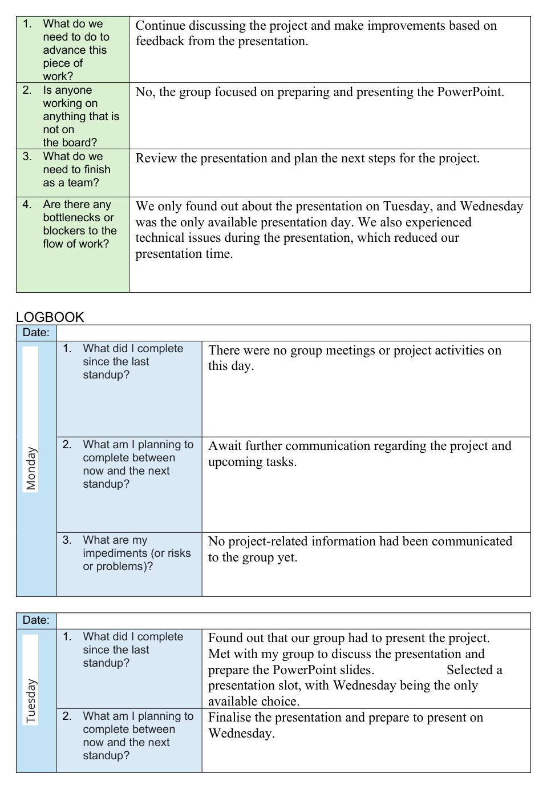

# Book Swap SA — Agile Digital Portfolio

**Second-Hand Textbook Swap | PRP372S — Project Presentation 3**  
**Cape Peninsula University of Technology (CPUT)**  
**Student:** Litha Owethu Mazibuko  
**Role:** Project Facilitator / Scrum Master

### 🌐 View My Portfolio

**[Open My Book Swap SA Agile Portfolio Website](https://litha2810.github.io/Digital-Portfolio/)**

[GitHub Repository](https://github.com/Litha2810/Digital-Portfolio) | [Project Trello Board](https://trello.com/b/zw19sdMT)

---

## Table of Contents

- [Project Overview](#project-overview)
- [My Role and Contribution](#my-role-and-contribution)
- [Portfolio Assessment Map](#portfolio-assessment-map)
- [1. Agile Team Charter](#1-agile-team-charter)
- [2. User Stories and Tasks](#2-user-stories-and-tasks)
- [3. Product Backlog](#3-product-backlog)
- [4. Sprint Backlog](#4-sprint-backlog)
- [5. Agile Logbook](#5-agile-logbook)
- [How the Artefacts Connect](#how-the-artefacts-connect)
- [Evidence and Referencing Notes](#evidence-and-referencing-notes)

---

## Project Overview

Book Swap SA is a student-focused project intended to help CPUT students **find, buy, sell and exchange affordable second-hand textbooks**.

The platform aims to address the high cost of academic textbooks while encouraging the reuse of learning materials among students.

The primary objectives of the project include:

- Improving access to affordable textbooks.
- Supporting the buying, selling and exchange of textbooks.
- Providing textbook searching and filtering functionality.
- Creating a user-friendly and responsive website.
- Promoting the reuse of academic resources.
- Encouraging collaboration among students.

This individual Agile Digital Portfolio presents evidence of our team's planning and project activities.

It also documents my personal learning and development as **Project Facilitator / Scrum Master**.

The portfolio contains the five Agile artefacts required for the PRP372S assessment:

1. Agile Team Charter
2. User Stories and Tasks
3. Product Backlog
4. Sprint Backlog
5. Agile Logbook

Each section contains **supporting evidence and a personal reflection using the STAR method**.

Our team used Trello to organise **54 day-based task cards across seven planned sprints**.

The original Trello board, Team Charter and dated Agile Logbook records are retained as supporting evidence.

---

## My Role and Contribution

My assigned role in Book Swap SA was **Project Facilitator / Scrum Master**.

According to the original Agile Team Charter, my responsibilities included:

- Facilitating Agile stand-ups and progress discussions.
- Supporting communication between team members.
- Encouraging the use of Agile working practices.
- Monitoring sprint progress through the Agile Logbook.
- Supporting team collaboration and accountability.
- Helping maintain visibility of planned and outstanding activities.
- Encouraging constructive discussions about challenges and improvements.

The role required me to understand how different team responsibilities contributed towards the project's shared objectives.

### Team Members and Assigned Roles

| Team Member | Assigned Role |
|---|---|
| Litha Owethu Mazibuko | Project Facilitator / Scrum Master |
| Samkelo Mahlangu | Product Owner / Content Lead |
| Coben Maistry | Frontend Developer |
| Angelia Van der Westhuizen | UI/UX and Quality Assurance Lead |
| Ongeziwe Raqa | Deployment and Documentation Lead |

These roles are documented in the original Agile Team Charter.

My responsibility was primarily to support the Agile process and team coordination rather than independently implement every technical feature.

---

## Portfolio Assessment Map

The PRP372S assessment allocates **10 marks for Evidence and 10 marks for Reflection** in each of the five required sections.

| Agile Artefact | Evidence | Reflection | Portfolio Section |
|---|---:|---:|---|
| Agile Team Charter | 10 | 10 | [View Section](https://litha2810.github.io/Digital-Portfolio/#team-charter) |
| User Stories and Tasks | 10 | 10 | [View Section](https://litha2810.github.io/Digital-Portfolio/#user-stories) |
| Product Backlog | 10 | 10 | [View Section](https://litha2810.github.io/Digital-Portfolio/#product-backlog) |
| Sprint Backlog | 10 | 10 | [View Section](https://litha2810.github.io/Digital-Portfolio/#sprint-backlog) |
| Agile Logbook | 10 | 10 | [View Section](https://litha2810.github.io/Digital-Portfolio/#agile-logbook) |
| **Total Available** | **50** | **50** | **100 Marks** |

The evidence and reflections are organised using the e-portfolio approach:

**Collect → Select → Reflect → Connect**

---

## 1. Agile Team Charter

### Evidence

**[View Original Agile Team Charter PDF](evidence/agile-team-charter.pdf)**

The Agile Team Charter establishes the team's shared purpose, roles, responsibilities, values, communication arrangements and development goals.

It provides a foundation for teamwork, collaboration and accountability throughout the Book Swap SA project.

The original Team Charter documents:

- The project purpose and vision.
- The five team members and their responsibilities.
- Shared values and Agile principles.
- Communication and collaboration arrangements.
- Planned development objectives.
- Expectations for teamwork and accountability.

The team's documented communication methods include WhatsApp, virtual check-ins, weekly progress meetings and GitHub for collaboration and version control.

Trello was used to organise project tasks and support progress visibility.

**Why I selected this evidence:**

I selected the original Team Charter because it establishes the responsibilities and working arrangements agreed upon by the team.

It also records my assigned role as Project Facilitator / Scrum Master.

### Personal Reflection — STAR Method

#### Situation

Book Swap SA was a five-member group project requiring us to establish a shared understanding of our objectives and responsibilities.

The Agile Team Charter documented the team's purpose, assigned roles, values and communication methods.

Clearly defined expectations were important because the project involved different responsibilities, including requirements planning, frontend development, UI/UX design, testing, deployment and documentation.

#### Task

As **Project Facilitator / Scrum Master**, my responsibility was to support the Agile working process, facilitate stand-ups and monitor sprint progress through the logbook.

I needed to understand how my assigned responsibilities related to those of the Product Owner, Frontend Developer, UI/UX and Quality Assurance Lead, and Deployment and Documentation Lead.

#### Action

I reviewed the Team Charter's role descriptions, communication arrangements and agreed working principles.

I connected these responsibilities to the information needed during project coordination, including task ownership, progress updates, blockers and planned activities.

This review helped me understand the importance of supporting communication while respecting the responsibilities allocated to other team members.

The charter establishes the agreed process, although it does not independently verify that every planned meeting or activity occurred.

#### Result and Learning

The Team Charter helped me understand that effective Agile leadership involves facilitating collaboration rather than controlling every team member's responsibilities.

I learned that clearly documented roles and communication expectations can reduce misunderstandings and support accountability.

I also recognised that team agreements should be reviewed when responsibilities or project requirements change.

In future projects, I would encourage regular reviews of the Team Charter and clearer records of decisions, blockers, task owners and follow-up actions.

This experience strengthened my understanding of **leadership through facilitation, communication, teamwork and accountability**.

**[Read the Complete Team Charter Section](https://litha2810.github.io/Digital-Portfolio/#team-charter)**

---

## 2. User Stories and Tasks

### Evidence

User stories describe software requirements from the perspective of the people who will use the system.

For Book Swap SA, they help the team understand the needs of students who want to discover affordable academic textbooks.

The original Trello board contains a card titled:

**Sprint 5: Day 37: Develop Search and Filter Functionality**

The card records the following user story:

> As a student, I want to search and filter textbook listings so that I can quickly find books that match my academic needs.

### Original Trello User Story Screenshot

*Figure 1: Original Trello card documenting the search and filter user story, Sprint 5 label and assigned team members.*

**What this evidence demonstrates:**

- A requirement was recorded from the student's perspective.
- The requirement was associated with Sprint 5.
- The card identified a planned development activity.
- Assigned team members were visible on the card.
- The requirement was documented on the team's Trello board.

The visible screenshot does not show the full checklist contents or verified acceptance criteria.

### Proposed Acceptance Criteria

The following criteria could be used to assess the expected search and filter functionality:

1. Students can enter a textbook title or keyword.
2. The system displays relevant matching textbooks.
3. Students can select supported filtering options.
4. Search results reflect the selected filters.
5. Appropriate feedback appears when no results are found.
6. Filters can be cleared to view the broader list again.

These are proposed criteria rather than verified completed tests.

### Development Tasks

The requirement can be divided into the following activities:

- Create the textbook search field.
- Implement search functionality.
- Develop filtering controls.
- Apply the selected filters.
- Display matching results.
- Test matching and unsuccessful searches.
- Test the filter controls and reset functionality.

### Personal Reflection — STAR Method

#### Situation

During Sprint 5, the Book Swap SA Trello board contained a card for developing search and filter functionality.

The user story focused on helping students quickly locate textbooks that matched their academic requirements.

The screenshot demonstrated that the requirement was recorded and assigned to team members, although the full checklist and testing outcomes were not visible.

#### Task

As **Project Facilitator / Scrum Master**, my responsibility was to support clear communication, task coordination and visibility of planned project activities.

I needed to understand how user requirements related to development tasks and how these could be monitored within the Agile workflow.

#### Action

I reviewed the wording of the recorded Trello user story and examined how it related to the proposed search and filtering requirements.

I considered the smaller tasks needed to support the feature, including search input, filtering controls, displaying results and testing different search outcomes.

I also examined the importance of acceptance criteria in defining when a feature meets the user's needs.

This process helped me distinguish between documenting a requirement and providing evidence that it had been implemented and tested.

#### Result and Learning

I learned that effective user stories focus on the user's needs and explain the value of the proposed functionality.

Acceptance criteria are important because they provide measurable expectations for evaluating the feature.

As Scrum Master / Project Facilitator, I recognised that clearly documented requirements make it easier for team members to understand tasks and coordinate development activities.

In future projects, I would encourage the team to refine user stories collaboratively, document acceptance criteria and maintain clear task responsibilities.

I would also encourage progress reviews that compare completed work with the agreed requirements.

This artefact strengthened my understanding of **user-centred requirements, task planning, collaboration and Agile coordination**.

**[Read the Complete User Stories and Tasks Section](https://litha2810.github.io/Digital-Portfolio/#user-stories)**

---

## 3. Product Backlog

### Evidence

The Product Backlog is the organised list of work planned for Book Swap SA.

The team's Trello board contains **54 day-based task cards organised across seven planned sprints**.

### Product Backlog Structure

| Sprint | Focus |
|---|---|
| Sprint 1 | Project Initiation and Business Planning |
| Sprint 2 | Business Plan Development |
| Sprint 3 | System Analysis and Design |
| Sprint 4 | UI/UX Design and Prototype Development |
| Sprint 5 | Core System Development |
| Sprint 6 | Testing and Quality Assurance |
| Sprint 7 | Project Finalisation and Submission |

### Original Trello Product Backlog Evidence

*Figure 2: Original Trello Product Backlog evidence from the Book Swap SA project.*

**[View the Original Trello Board](https://trello.com/b/zw19sdMT)**

**[View All Product Backlog Screenshots](https://litha2810.github.io/Digital-Portfolio/#product-backlog)**

The Product Backlog helps the team:

- Organise planned activities.
- Identify project requirements.
- Understand the seven-sprint structure.
- Maintain visibility of task responsibilities.
- Review checklist progress.
- Identify outstanding work.

The board provides evidence of planned tasks and recorded progress, but the existence of a card alone does not establish that the activity was completed.

### Personal Reflection — STAR Method

#### Situation

Our Book Swap SA project involved numerous planning, design, development, testing and documentation activities.

The team organised 54 day-based Trello task cards across seven planned sprints.

The size of the project made effective planning, task visibility and coordination important.

#### Task

As **Project Facilitator / Scrum Master**, my responsibility was to support the team's Agile process and maintain awareness of planned and outstanding work.

The Product Owner / Content Lead was responsible for product prioritisation, while my facilitation role focused on communication, task visibility and progress coordination.

#### Action

I reviewed the Product Backlog structure and examined how project activities were organised across the seven sprints.

I considered how early requirements and design activities related to later development and testing tasks.

I also examined the importance of reviewing task descriptions, responsibilities and checklist information to understand recorded progress.

This helped me distinguish between the planned sequence of activities and evidence of actual completion.

#### Result and Learning

The Product Backlog helped me understand how a complex project can be organised into smaller and more manageable activities.

I learned that a clear backlog improves transparency and supports communication between team members.

I also recognised that the order of tasks should be linked to project needs and dependencies rather than treated as an automatic indication of priority or completion.

In future projects, I would encourage regular backlog refinement, clearer task descriptions and consistent progress updates.

I would also encourage better documentation of dependencies and reasons for changes in the project plan.

This artefact strengthened my understanding of **Agile planning, task organisation, accountability and progress visibility**.

---

## 4. Sprint Backlog

### Evidence

The Sprint Backlog organises planned work into smaller activities associated with specific sprint objectives.

The Book Swap SA team used Trello to document work across seven sprints.

The same Trello board serves as evidence for both the Product Backlog and Sprint Backlog, with different screenshots selected for their relevance.

### Sprint Backlog Overview

| Sprint | Planned Activities |
|---|---|
| Sprint 1 | Problem statement, stakeholder identification, research and SWOT analysis |
| Sprint 2 | Business goals, mission, vision, marketing and financial planning |
| Sprint 3 | Requirements, user stories, architecture, database design and wireframes |
| Sprint 4 | Homepage, registration page, dashboard and textbook interface designs |
| Sprint 5 | Registration, login, textbook listings, search and filtering |
| Sprint 6 | Functional testing, bug fixing and User Acceptance Testing |
| Sprint 7 | Documentation, final project review, presentation and submission |

### Original Sprint Backlog Evidence

*Figure 3: Original Sprint 5 Trello development task evidence.*

**[View Sprint Backlog Evidence](https://litha2810.github.io/Digital-Portfolio/#sprint-backlog)**

The Trello evidence demonstrates how planned project activities were associated with particular sprints.

It also provides visibility of task descriptions and available checklist information.

The actual completion status of each activity must be checked against the original project records.

### Personal Reflection — STAR Method

#### Situation

Book Swap SA was organised into seven planned sprints, with each sprint focusing on particular project activities.

The sprint structure covered project initiation, business planning, system analysis, interface design, development, testing and final submission.

The tasks depended on effective coordination between members with different responsibilities.

#### Task

As **Project Facilitator / Scrum Master**, my responsibility was to support sprint coordination, communication and progress monitoring.

I needed to understand the planned activities, associated responsibilities and potential challenges that could affect sprint progress.

#### Action

I reviewed the sprint-specific Trello cards and examined how activities were divided across the project stages.

I considered the relationship between sprint objectives, assigned activities and task dependencies.

I also identified information that would be useful during progress discussions, including task ownership, checklist status, obstacles and agreed next steps.

This review reinforced the importance of distinguishing planned work from verified completed activities.

#### Result and Learning

The Sprint Backlog helped me understand the value of organising work into smaller stages with clear objectives.

I learned that effective sprint coordination depends on communication, accountability and awareness of outstanding tasks.

I also recognised that a sprint plan should be reviewed regularly because development activities may be affected by delays, changing requirements or other challenges.

In future projects, I would encourage clearer sprint goals, more consistent progress discussions and better documentation of blockers.

I would also ensure that sprint reviews distinguish unfinished work from work that has been completed and accepted.

This experience strengthened my understanding of **sprint planning, coordination, progress monitoring and continuous improvement**.

---

## 5. Agile Logbook

### Evidence

The Agile Logbook documents project activities, progress, planned work, challenges and lessons learned during development.

The original Book Swap SA Agile Logbook includes dated records from July and August 2026.

### Recorded Reporting Periods

| Reporting Period | Documented Focus |
|---|---|
| 14–17 July 2026 | Business Proposal Preparation and Presentation |
| 20–24 July 2026 | Product Backlog, User Stories and Project Planning |
| 10–14 August 2026 | Project Progress Reviews, Trello Tracking and Feedback |

### Original Agile Logbook Screenshot

*Figure 4: Original Agile Logbook evidence from July 2026.*

**[View All Eight Agile Logbook Screenshots](https://litha2810.github.io/Digital-Portfolio/#agile-logbook)**

### Recorded Project Activities

**14–17 July 2026 — Business Proposal Preparation**

The project records describe preparation and presentation of the Book Swap SA business proposal.

Challenges included limited preparation time and technical difficulties during the presentation.

These records highlighted the importance of preparation, communication and adaptability.

**20–24 July 2026 — Product Backlog and Planning**

The records describe reviewing requirements, developing user stories, improving backlog items and discussing project planning activities.

Task distribution and realistic prioritisation were important considerations.

**10–14 August 2026 — Progress Reviews and Feedback**

The records describe discussions about project progress, Trello task information, planning updates and feedback.

They demonstrate the importance of reviewing activities and maintaining visibility of outstanding work.

### Personal Reflection — STAR Method

#### Situation

The original Agile Logbook contains dated records from July and August 2026.

These records document activities relating to the business proposal, requirements planning, backlog development and project progress reviews.

The recorded presentation difficulties and planning discussions highlighted the importance of communication and effective coordination.

#### Task

As **Project Facilitator / Scrum Master**, my assigned responsibility included monitoring sprint progress through the Agile Logbook and supporting effective team communication.

The logbook provided a way to understand recorded activities, planned work and challenges.

#### Action

I reviewed the original dated Agile Logbook entries alongside the Trello planning records.

I organised the information into reporting periods and identified the main activities, challenges and learning opportunities documented during each period.

I examined the importance of recording completed activities, planned next steps and obstacles during progress discussions.

I also considered how these records could support more effective follow-up and improve visibility of project responsibilities.

#### Result and Learning

The Agile Logbook helped me understand the importance of accurate documentation and regular progress reviews.

The recorded presentation challenges demonstrated the need for early preparation, contingency planning and clear communication.

The backlog planning activities highlighted the importance of manageable tasks, responsibility allocation and realistic priorities.

The August reviews reinforced the value of checking progress and identifying outstanding work.

In future projects, I would encourage more consistent dated logbook entries and clearer records of decisions, blockers and next steps.

I would also aim to ensure that each progress discussion identifies responsible team members and actions requiring follow-up.

This artefact strengthened my understanding of **Agile project monitoring, communication, reflection, accountability and continuous improvement**.

---

## How the Artefacts Connect

The five Agile artefacts demonstrate how different project management activities contribute towards the shared objectives of Book Swap SA.

### Agile Team Charter

Establishes the project purpose, team roles, shared values and communication arrangements.

### User Stories and Tasks

Identify the needs of students and translate those requirements into proposed system features and development tasks.

### Product Backlog

Organises the planned work needed to address project requirements and achieve the project's objectives.

### Sprint Backlog

Divides planned activities into smaller tasks associated with individual sprints.

### Agile Logbook

Provides dated records of project activities, progress, challenges and lessons learned.

Together, these artefacts demonstrate the e-portfolio learning process:

**Collect → Select → Reflect → Connect**

Through the development and review of these artefacts, I gained a deeper understanding of Agile teamwork, planning, project facilitation and continuous improvement.

My role as Scrum Master / Project Facilitator showed me the importance of effective communication, accountability, clear responsibilities and accurate progress information.

---

## Evidence and Referencing Notes

### Primary Project Evidence

- Original Book Swap SA Agile Team Charter.
- Original Book Swap SA Trello board.
- Product Backlog and Sprint Backlog screenshots.
- Sprint 5, Day 37 User Story screenshot.
- Original dated Agile Logbook records.

### Assessment Reference

Cape Peninsula University of Technology (CPUT). (2026). *PRP370/371/372S Assessment 2 — October 2026*. Project Presentation 3.

### Agile Project Management Tool

**Trello:** [Book Swap SA Project Board](https://trello.com/b/zw19sdMT)

### Academic Integrity

This portfolio distinguishes between proposed functionality, planned activities, recorded project evidence and verified completed work.

The STAR reflections explain my learning and understanding of the responsibilities associated with my role as Project Facilitator / Scrum Master.

Claims of completed activities or implemented functionality should be supported by the original project records.

---

**[Back to Top](#book-swap-sa--agile-digital-portfolio)**

**[Open My Live Agile Portfolio](https://litha2810.github.io/Digital-Portfolio/)**
