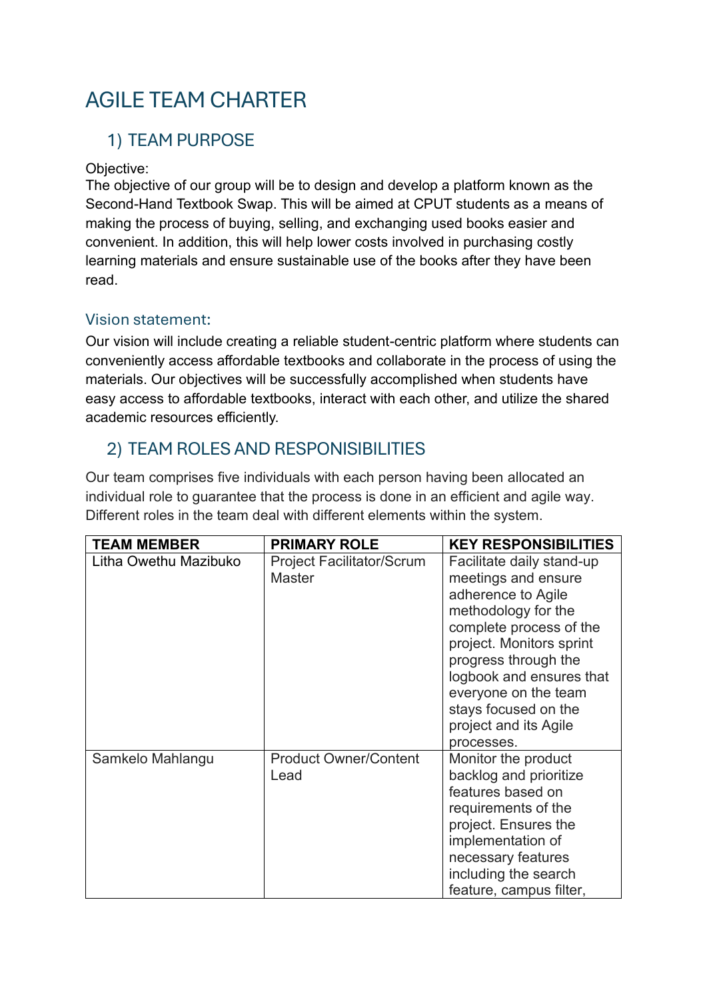
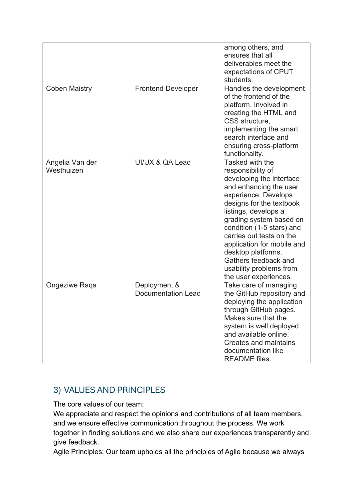
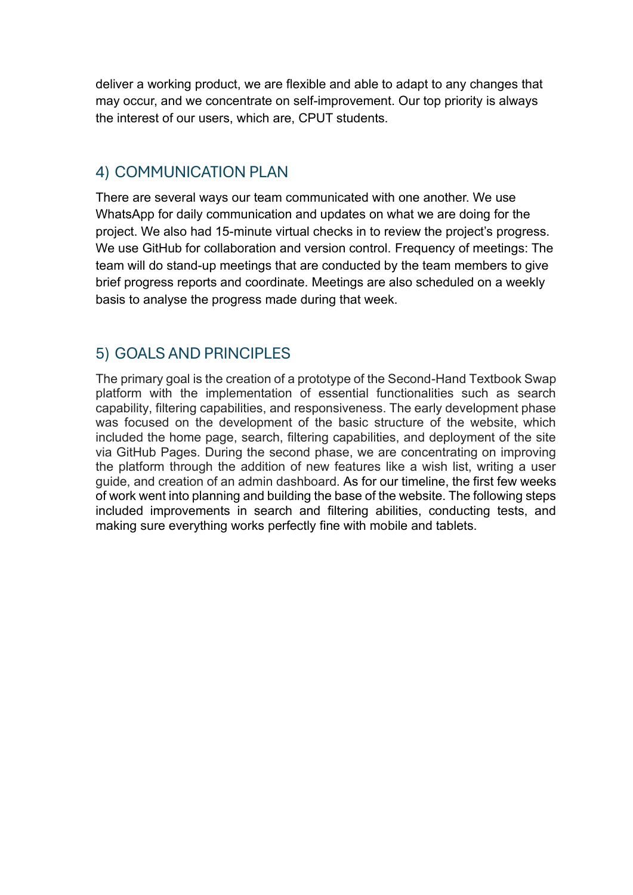

# Digital Portfolio

## Litha Owethu Mazibuko

Final-Year Information Technology Student  
Cape Peninsula University of Technology · Cape Town, South Africa

[GitHub](https://github.com/Litha2810) · [Email](mailto:litha.mzbk@gmail.com) · [View my CV](https://github.com/Litha2810/Digital-Portfolio/blob/efdc2b85df63bd8c41b70f9a943c8e84ba31ca1e/CV/Litha's%20Cv.pdf.pdf)

---

## Table of Contents

- [Profile](#profile)
- [Personal Details](#personal-details)
- [Curriculum Vitae (CV)](#curriculum-vitae-cv)
- [Professional Experience](#professional-experience)
- [Achievements](#achievements)
- [Languages](#languages)
- [Education](#education)
- [Technical Skills](#technical-skills)
- [Projects](#projects)
  - [Other Projects I Have Worked On](#other-projects-i-have-worked-on)
  - [Freight and Delivery System](#freight-and-delivery-system)
  - [Safety App](#safety-app)
  - [Student Enrollment System](#student-enrollment-system)
- [References](#references)
- [Contact Information](#contact-information)
- [Mock Interview Video](#mock-interview-video)
- [Reflections](#reflections)
  - [Coding My CV in Markdown](#reflection-1--coding-my-cv-in-markdown-star-method)
  - [Mock Interview Experience](#reflection-2--mock-interview-experience-star-method)
  - [Using GitHub Pages](#reflection-3--using-github-pages-star-method)
- [Professional Profile](#professional-profile)
- [Agile Portfolio of Evidence](#agile-portfolio-of-evidence)
  - [Role Explanation](#role-explanation--requirements-and-backlog-coordinator)
  - [Agile Team Charter](#agile-team-charter)
  - [User Stories and Tasks](#user-stories-and-tasks)
  - [Product Backlog](#product-backlog)
  - [Sprint Backlog](#sprint-backlog)
  - [Agile Logbook](#agile-logbook)
  - [Evidence Sources](#evidence-sources)

---

---

## Profile

I am a motivated final-year Information Technology student at Cape Peninsula University of Technology. My studies have introduced me to programming, web development and database systems, while my administrative and customer service experience has strengthened my communication, organisation and attention to detail.

I enjoy solving problems, learning new technologies and working with others. I am seeking an opportunity to apply my academic knowledge in a professional environment, develop my technical abilities and contribute to useful software solutions. This digital portfolio showcases my skills, experience, projects, CV, and reflections completed as part of my Work Readiness Training.

---

## Personal Details

- Date of Birth: 28 October 2005
- Marital Status: Single
- Nationality: South African
- Gender: Female
- Home Language: IsiXhosa
- Other Languages: English, Afrikaans, IsiZulu

---

## Curriculum Vitae (CV)

[View my CV](https://github.com/Litha2810/Digital-Portfolio/blob/efdc2b85df63bd8c41b70f9a943c8e84ba31ca1e/CV/Litha's%20Cv.pdf.pdf)

---

## Professional Experience

### Administration Assistant — Zuthama Holdings PTY LTD

December 2023–June 2025
- Requested quotations and tax invoices from service providers.
- Captured and processed invoices and quotations.
- Assisted with completing tender documents.
- Liaised with stakeholders by telephone and email.
- Maintained physical and electronic filing systems and handled general enquiries.
  

### Waitress, Winter Job — Black Impala Restaurant

June 2024–July 2024
- Welcomed guests, took orders and communicated with kitchen staff.
- Served food and beverages and checked customer satisfaction.
- Processed payments using a point-of-sale system.
- Maintained a clean and organised service area.
  

---

## Achievements

- Matric A aggregate of 81.3%.
- Deputy Head Girl — Noorder Paarl High School, 2023.
- Member of the Student Representative Council, 2023.
- Top achiever for three consecutive years.
- Head of the Radio Club.
  

---

## Languages

IsiXhosa (home language), English, Afrikaans and IsiZulu.

---

## Education

### Diploma in Information Technology

Cape Peninsula University of Technology (CPUT) · Cape Town, South Africa
2024–Present · Final Year

### National Senior Certificate

Noorder Paarl High School
2023 · A aggregate: 81.3%

---

## Technical Skills

### Languages and Web Development

- Java
- PHP
- HTML and CSS
- JavaScript
- Markdown
  

### Databases

- MySQL

### Developer and Productivity Tools

- GitHub and GitHub Pages
- Microsoft Word, Excel and Outlook
- Data capturing and electronic document organisation
  

### Professional Skills

- Time management and attention to detail
- Problem-solving
- Customer service
- Independent work and teamwork
- Professional telephone and email communication

---

## Projects

### Other Projects I Have Worked On

My academic projects have explored logistics, personal safety and student administration. They have provided different contexts for applying programming, database concepts and user-centred design.

### Freight and Delivery System

A group application focused on managing freight operations, including shipment bookings, pickups and deliveries. The project provided a context for applying software development and system-design concepts to a logistics business.

The application demonstrates the connection between business requirements and a structured software solution. Individual contribution evidence should identify my own work within the group project.

### Safety App

A safety-focused application designed to assist users in emergency situations. The project emphasised usability, quick access to important functions and user-centred problem-solving.

The project demonstrates the importance of understanding user needs when deciding how information and functions should be presented.

### Student Enrollment System

An academic application for managing student registrations and course enrolments. The project involved structured data handling and database functionality.

The project provided a practical context for considering how student records are organised, captured and retrieved.

---

## References

### Thandolwethu Siwisa

Manager – Black Impala  
📞 [064 575 5467](tel:+27645755467)

### Zukiswa Ngoqo

Director – Zuthama Holdings PTY LTD  
📧 [zngoqo78@gmail.com](mailto:zngoqo78@gmail.com)  
📞 [060 712 2310](tel:+27607122310)

### Natalie Arendse

Principal – Noorder Paarl High School  
📞 [021 862 9810](tel:+27218629810)

### Ronique Minnaar

Teacher / Mentor  
📞 [071 332 5853](tel:+27713325853)

---

## Contact Information

📍 14 Raivenscraig Rd, Woodstock, Cape Town  
📞 [067 405 3861](tel:+27674053861) / [072 179 8243](tel:+27721798243)  
📧 [litha.mzbk@gmail.com](mailto:litha.mzbk@gmail.com)  
🔗 [My GitHub Profile](https://github.com/Litha2810)

---

## Mock Interview Video

[My Mock Interview Video](https://mycputac-my.sharepoint.com/personal/240143485_mycput_ac_za/_layouts/15/stream.aspx?id=%2Fpersonal%2F240143485%5Fmycput%5Fac%5Fza%2FDocuments%2FMock%20Interview%20Video%2EMOV&ga=1&referrer=StreamWebApp%2EWeb&referrerScenario=AddressBarCopied%2Eview%2Edc40e455%2D75db%2D43b4%2Dafcd%2Dc40c9505640c)

The video forms part of my Work Readiness Training portfolio. It provides evidence of practising interview communication and presenting myself professionally.

---

## Reflections

### Reflection 1 — Coding My CV in Markdown (STAR Method)

#### Situation

I was required to create a professional digital portfolio using GitHub and Markdown formatting.

#### Task

My task was to present my education, experience, technical skills and projects in a clear CV using Markdown. The content needed to remain readable and easy to navigate when displayed through GitHub.

#### Action

I researched Markdown syntax and practised using headings, bullet points, hyperlinks and formatting techniques. I used these elements to separate my education, skills, experience and projects, and linked supporting material such as my CV and interview video. Organising the content required me to consider both what a reader needed to know and how easily that information could be found.

#### Result

I created a structured digital portfolio and improved my technical documentation skills. The exercise helped me understand that professional presentation depends on accurate content and consistent organisation as well as appearance. In future updates, I would strengthen project descriptions with direct evidence of my own contribution and check all links after making changes.

### Reflection 2 — Mock Interview Experience (STAR Method)

#### Situation

As part of the Work Readiness programme, I was required to participate in and record a mock interview.

#### Task

My responsibility was to answer interview questions professionally, communicate my strengths clearly and demonstrate confidence. I needed to present my academic learning and work experience in a way that a potential employer could understand.

#### Action

I prepared by researching common interview questions and practising my responses. I considered how to explain my education, experience and skills, and worked on my communication and body language before recording. The preparation encouraged me to organise my ideas instead of relying only on an immediate response.

#### Result

The mock interview helped build my confidence and ability to present myself professionally. I learned that preparing examples is important because a statement about a skill becomes more useful when it is supported by a specific experience. In future interviews, I would use the STAR structure to explain my individual actions and outcomes more clearly, while keeping answers focused on the question.

### Reflection 3 — Using GitHub Pages (STAR Method)

#### Situation

I was required to publish my digital portfolio using GitHub Pages.

#### Task

My task was to publish my repository content through GitHub Pages and make the portfolio accessible through a website link. This required me to understand the relationship between the repository holding the files and the website presenting them.

#### Action

I learned how GitHub Pages works by configuring my repository settings and publishing the portfolio site. I used Markdown to organise the content for online presentation and connected relevant portfolio resources through hyperlinks. This introduced me to the practical responsibility of maintaining files that other people need to access.

#### Result

I gained practical experience in website publishing and improved my understanding of GitHub as both a collaboration platform and a way to present documentation. I learned that uploading files is only one part of publishing: the final website must also be checked for readable content, working links and accessible evidence. I would make those checks part of every future portfolio update.

---

## Professional Profile

Motivated and detail-oriented Information Technology student currently in my third year at Cape Peninsula University of Technology. I have strong administrative and customer service experience, complemented by developing technical knowledge in IT. I am eager to gain practical experience in a professional environment where I can apply my problem-solving skills, grow my technical abilities, and contribute effectively to a team.

---

## Agile Portfolio of Evidence

**Project:** Second-Hand Textbook Swap

**Module:** PRP372S — Project Presentation 3

**Role recorded in the original charter:** Project Facilitator / Scrum Master

**Proposed additional role:** Requirements and Backlog Coordinator

[View the project Trello board](https://trello.com/b/zw19sdMT)

The project aims to help CPUT students buy, sell and exchange second-hand textbooks. It addresses textbook affordability and encourages the reuse of academic resources.

This section separates team planning documents from evidence of individual work. The uploaded charter is available in full, with screenshots of its content below. The Trello board requires account access in the review environment; its cards and completion states have not been independently inspected for this update.

### Role Explanation — Requirements and Backlog Coordinator

The Requirements and Backlog Coordinator supports the Product Owner by helping document student needs, clarify user stories, organise related tasks and identify dependencies. This role is similar to Samkelo’s Product Owner / Content Lead role because both connect requirements to student value. The Product Owner remains responsible for priority decisions; the coordinator supports the clarity and traceability of the work.

This is a proposed extension discussed for this portfolio. The original charter records my role as Project Facilitator / Scrum Master. It should only be recorded as an additional role performed if agreed by the team and supported by my actual work.

### Agile Team Charter

#### Evidence

[View the Agile Team Charter](evidence/agile-team-charter.pdf)

It defines the project purpose, team roles, values, communication plan and development goals.

| Team member | Role recorded in the charter |
| --- | --- |
| Litha Owethu Mazibuko | Project Facilitator / Scrum Master |
| Samkelo Mahlangu | Product Owner / Content Lead |
| Coben Maistry | Frontend Developer |
| Angelia Van der Westhuizen | UI/UX and QA Lead |
| Ongeziwe Raqa | Deployment and Documentation Lead |

My assigned responsibilities include facilitating stand-ups, supporting adherence to Agile practices and monitoring sprint progress through the logbook. These responsibilities differ from the Product Owner's backlog-prioritisation role.

#### Charter Screenshot — Project Purpose and My Assigned Role

Source: original team charter, page 2. This page records assigned responsibilities; it does not independently prove that particular meetings occurred.

#### Charter Screenshot — Team Responsibilities

Source: original team charter, page 3. Responsibilities provide context for identifying individual and shared contributions.

#### Charter Screenshot — Communication and Development Goals

Source: original team charter, page 4. WhatsApp updates, virtual check-ins, weekly progress meetings and GitHub collaboration are described as intended working arrangements.

#### Reflection — Understanding My Facilitation Responsibilities (STAR Method)

##### Situation

The Second-Hand Textbook Swap project required five team members to coordinate their work towards a shared student need. The charter established a common purpose and allocated responsibilities across facilitation, requirements, development, design, testing and deployment.

##### Task

My assigned role was Project Facilitator / Scrum Master. The charter made me responsible for supporting team coordination, facilitating stand-ups and monitoring sprint progress through the logbook.

##### Action

In reviewing the charter for this portfolio, I identify the responsibilities assigned to me and compare them with the records needed to demonstrate the role. The charter provides a clear starting point: facilitating stand-ups, encouraging Agile working practices and using the logbook to monitor progress. I distinguish these assigned responsibilities from the implementation responsibilities allocated to other members.

##### Result and Learning

The charter makes the boundaries between my role and the other roles visible. It provides a basis for checking whether my contribution supported coordination and progress rather than claiming responsibility for every feature. To demonstrate the role fully, I need to connect it to dated records of my actions and their outcomes.

This review highlights a practical improvement: connect each responsibility to a dated example, such as a recorded follow-up action or progress update. That would make the relationship between the charter and the work carried out easier to assess. The charter alone cannot establish the outcome of a meeting or coordination action.

### User Stories and Tasks

#### Evidence — Connecting Student Needs to Planned Work

[View the project Trello board](https://trello.com/b/zw19sdMT)

The team portfolio supplied as a formatting reference describes a student story about finding relevant textbooks through search and filtering. It lists planned work covering search, keyword matching, filters, sorting, testing and issue resolution. These details must be checked against the actual card before they are presented as verified Trello evidence here.

My charter role is facilitation. Search and campus-filter implementation described in the reference portfolio belongs to its author and is not claimed as my individual work.

User-story screenshot: Awaiting the actual Trello image. Capture the card title, story and acceptance criteria where available.
<!-- After adding the real screenshot, remove this comment wrapper:

-->
Task screenshot: Awaiting the actual checklist image. Include recorded task allocations and completion states.
<!-- After adding the real screenshot, remove this comment wrapper:

-->

#### Reflection — Supporting Clear and Manageable Tasks (STAR Method)

##### Situation

A broad feature such as finding relevant textbooks needs to be divided into smaller tasks so the team can discuss ownership and progress.

##### Task

My assigned facilitator role provides a basis for helping the team identify unclear tasks, dependencies and issues that need follow-up.

##### Action

For this portfolio review, I connect the search-and-filter requirement described in the supplied team material to its planned task breakdown. I separate the student outcome from the development activities: finding a relevant textbook is the goal, while search, filters, sorting and testing are pieces of work contributing to it. I also identify where the actual card and checklist screenshots are needed to support that connection.

##### Result and Learning

A user story explains the student's goal, while its tasks make the work more specific. For my role, the value lies in helping the team maintain a clear connection between that goal, the work assigned and the progress recorded.

Reviewing the distinction helps me understand why a checklist needs clear ownership and acceptance criteria. In future work, I would help the team clarify how a task will be checked and ensure that any change in ownership is recorded. The available materials do not establish that I implemented the search feature or completed its tests.

### Product Backlog

#### Evidence — Overall Product Scope

[View the project Trello board](https://trello.com/b/zw19sdMT)

The charter identifies the basic website structure, search, filtering, responsiveness and deployment as early project priorities. It also describes proposed later improvements such as a wishlist, user guide and admin dashboard. These are recorded plans, not proof that every feature was delivered.

The Product Owner is assigned responsibility for monitoring and prioritising the product backlog. My facilitator contribution must be described separately and supported by the relevant records.

Product-backlog screenshot: Awaiting a readable capture of the actual list. Show its title, item order and visible statuses; use additional images if the list is long.
<!-- After adding the real screenshot, remove this comment wrapper:

-->

| Backlog evidence to identify | Why it matters |
| --- | --- |
| Actual item title or ID | Identifies the requirement being discussed |
| Recorded priority or order | Shows how the work was arranged |
| Related sprint card | Connects the requirement to selected work |
| My dated contribution | Shows my involvement without replacing the Product Owner's role |

#### Reflection — Coordinating Work Within the Wider Plan (STAR Method)

##### Situation

The project needed to balance several requirements within the available time. The charter establishes a broad direction, but a current backlog is needed to make the planned work and changes visible.

##### Task

Within my facilitator role, I needed to support coordination around the work selected by the team and Product Owner.

##### Action

I use the charter and the supplied team portfolio to organise an account of the intended scope. The reference material links search and filtering across design, development and testing activities. Considering these together highlights a dependency: students need listings to exist before searching them is useful. This is an analytical review of the plan rather than a claim that I made a particular historical priority decision.

##### Result and Learning

A sequence of cards does not automatically explain why one feature is more important than another. Clear priority reasons and links to related sprint tasks would make the plan easier to interpret and progress easier to discuss.

The review makes the difference between product scope, priority and status clearer to me. In future work, I would support the Product Owner by recording dependencies and clarifying requirements, while ensuring that priority decisions remain visible and attributable. A direct backlog screenshot is still needed to verify its current order and state.

### Sprint Backlog

#### Evidence — Selected Sprint Work

[View the project Trello board](https://trello.com/b/zw19sdMT)

The supplied reference portfolio describes a list titled “Sprint 5: Core System Development”, including registration, login, profiles, listings, search/filtering, messaging, integration and review. This is context supplied in the example, rather than a direct inspection of the board for this README.

Sprint-list screenshot: Awaiting a capture of the actual sprint list, including its title and selected work.
<!-- After adding the real screenshot, remove this comment wrapper:

-->
Sprint-task screenshot: Awaiting the relevant card with its checklist, owners and status.
<!-- After adding the real screenshot, remove this comment wrapper:

-->
Sprint goal and dates: Not established by the material available for this update. The reference describes day-number planning labels; these must not be treated as verified calendar dates.

#### Reflection — Making Progress and Blockers Visible (STAR Method)

##### Situation

A sprint brings a smaller selection of product work into a focused development plan. The team needs to understand what is selected, who is responsible and what remains unresolved.

##### Task

My charter responsibilities include facilitating stand-ups and monitoring sprint progress through the logbook.

##### Action

For this portfolio, I relate the development activities described in the supplied Sprint 5 account to my assigned progress-monitoring responsibility. I distinguish the planned sprint work from evidence of completion. I also identify the records that would be necessary to explain progress: a sprint goal, selected cards, task owners, checklist status and dated follow-up notes. Without these records, I cannot establish actual blockers or completed work from a sprint title alone.

##### Result and Learning

A sprint backlog is most useful when its ownership and statuses reflect the work actually carried out. For my role, a specific example of follow-up and its outcome would demonstrate more than a screenshot of a planning list alone.

This review shows me why task status and ownership need regular attention. In future sprints, I would keep progress notes linked to the relevant cards and distinguish incomplete work from work accepted as complete. I would also retain sprint-review outcomes so that the result can be explained with evidence rather than inferred from the plan.

### Agile Logbook

#### Evidence — Project Progress Records

The charter assigns me responsibility for monitoring sprint progress through the logbook. No original logbook or stand-up minutes were supplied for this README update, so a historical logbook has not been invented.

Logbook screenshot: Awaiting an image of your actual dated entries. Show completed work, blockers, decisions, responsibility and follow-up where recorded.
<!-- After adding the real screenshot, remove this comment wrapper:

-->
If original notes are unavailable, a reconstructed record should be labelled as such. Give its actual compilation date and cite the source for each entry; do not present reconstructed entries as original meeting minutes.

| Available source | What it establishes | What it does not establish |
| --- | --- | --- |
| Original team charter | Assigned roles, intended communication and project direction | Meeting attendance, actual blockers or completed sprint outcomes |
| Supplied team portfolio example | Another member's description of planning records and their contribution | My individual actions or an independently inspected Trello state |
| Original dated notes or commits, when added | The specific event or change recorded | Other undocumented events |

#### Reflection — Recording the Process Alongside the Product (STAR Method)

##### Situation

The charter, user stories and backlogs explain different parts of a project, but they do not automatically preserve day-to-day decisions and progress.

##### Task

My assigned role includes using the logbook to monitor sprint progress. Evidence of that responsibility needs to show what was recorded and how it informed follow-up.

##### Action

I organise the sources available for this portfolio and identify what each can support. The charter records my assigned monitoring responsibility and intended communication arrangements. The supplied team portfolio describes planning records, but it does not provide my original logbook entries. I therefore separate the available evidence from missing daily records and avoid assigning unverified dates to project activities.

##### Result and Learning

A useful logbook connects work completed, problems, decisions and next steps over time. Short, consistent entries with evidence links would make individual contributions easier to explain and reduce reliance on memory when preparing a portfolio.

The missing records limit how fully the day-to-day process can be explained. In future work, I would keep a short dated entry after each check-in, recording completed work, next steps, blockers, decisions, owners and evidence links. After each sprint, I would record a review outcome and one practical improvement to follow up. These are proposed improvements, not claims that the missing entries exist.

#### Evidence Sources

Second-Hand Textbook Swap team (2026) Agile Team Charter. PRP372S — Project Presentation 3. Stated due date: 4 May. [Original PDF](evidence/agile-team-charter.pdf).

Textbook Swap SA (n.d.) Project board [Trello board]. Available at: [Textbook Swap SA board](https://trello.com/b/zw19sdMT). Access is restricted in the review environment. Access and screenshot-capture dates must be recorded when original board evidence is added.

---

[Back to top](#digital-portfolio)
