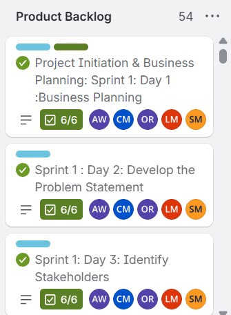
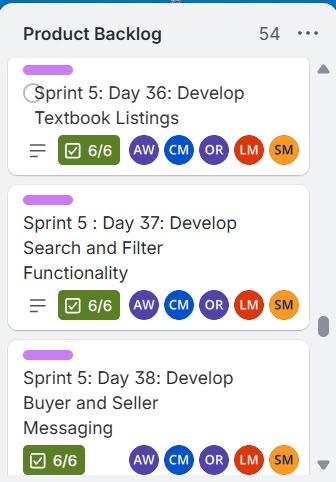

# Book Swap SA — Agile Digital Portfolio

### Second-Hand Textbook Swap

**Cape Peninsula University of Technology (CPUT)**  
**Module:** Project Presentation 3 (PRP372S)  
**Academic Year:** 2026  
**Student:** Litha Owethu Mazibuko  
**Assigned Role:** Project Facilitator / Scrum Master

---

### 🌐 My Digital Portfolio and GitHub Repository

**[View My Live Agile Digital Portfolio](https://litha2810.github.io/Digital-Portfolio/)**

**[View My Complete GitHub Repository](https://github.com/Litha2810/Digital-Portfolio)**

**[View Our Book Swap SA Trello Board](https://trello.com/b/zw19sdMT)**

The GitHub repository provides access to the portfolio source code, README, Agile evidence screenshots and supporting project documents.

---

## Table of Contents

1. [Project Overview](#project-overview)
2. [My Role and Responsibilities](#my-role-and-responsibilities)
3. [Project Team](#project-team)
4. [Assessment Rubric Alignment](#assessment-rubric-alignment)
5. [Agile Portfolio of Evidence](#agile-portfolio-of-evidence)
   - [1. Agile Team Charter](#1-agile-team-charter)
   - [2. User Stories and Tasks](#2-user-stories-and-tasks)
   - [3. Product Backlog](#3-product-backlog)
   - [4. Sprint Backlog](#4-sprint-backlog)
   - [5. Agile Logbook](#5-agile-logbook)
6. [Supporting Project Documentation](#supporting-project-documentation)
7. [How the Agile Artefacts Connect](#how-the-agile-artefacts-connect)
8. [Overall Personal Reflection](#overall-personal-reflection)
9. [Evidence and References](#evidence-and-references)
10. [Portfolio Submission Links](#portfolio-submission-links)

---

## Project Overview

### Introduction

Book Swap SA is a student-focused initiative developed to address the challenges associated with accessing affordable academic textbooks.

Students frequently face financial difficulties when purchasing prescribed learning materials. Textbooks may also become unused after a semester or academic year, even though other students still require them.

Book Swap SA was conceptualised as a platform where students could discover, buy, sell and exchange affordable second-hand textbooks.

The project promotes the reuse of academic resources while encouraging a more accessible and sustainable student marketplace.

### Project Problem Statement

The high cost of academic textbooks can create financial pressure for students.

At the same time, students who have completed their modules may own textbooks that are no longer needed.

Without an organised platform for connecting buyers and sellers, students may experience difficulty finding suitable second-hand textbooks.

Book Swap SA aims to address this problem by providing a student-centred solution for textbook discovery and exchange.

### Project Objectives

The main objectives of Book Swap SA include:

- Providing students with access to affordable second-hand textbooks.
- Supporting textbook discovery through searching and filtering.
- Creating a user-friendly and responsive platform.
- Encouraging the reuse of academic resources.
- Supporting communication and collaboration between students.
- Applying Agile project management practices during project planning and development.

These objectives describe the intended project outcomes. The available Agile evidence documents planning and project activities rather than independently proving that every proposed feature was implemented.

### Project Management Approach

Our team applied Agile project management principles to organise project activities into smaller, manageable stages.

The project was planned around **seven sprints**, with Trello used to organise **54 day-based task cards**.

The seven planned sprints covered:

1. Project Initiation and Business Planning.
2. Business Plan Development.
3. System Analysis and Design.
4. UI/UX Design and Prototype Development.
5. Core System Development.
6. Testing and Quality Assurance.
7. Project Finalisation and Submission.

The Agile approach supported task organisation, communication, progress visibility and opportunities for continuous improvement.

---

## My Role and Responsibilities

### Project Facilitator / Scrum Master

My assigned role in Book Swap SA was **Project Facilitator / Scrum Master**.

This role focused on supporting the Agile process, promoting communication and encouraging effective collaboration between team members.

According to our original Agile Team Charter, the responsibilities associated with my role included:

- Facilitating Agile stand-ups and project progress discussions.
- Supporting communication between team members.
- Encouraging adherence to Agile working practices.
- Monitoring sprint progress through the Agile Logbook.
- Supporting accountability and task visibility.
- Encouraging constructive discussions about challenges.
- Promoting collaboration and continuous improvement.

### My Contribution to the Agile Portfolio

My individual portfolio demonstrates my understanding of these responsibilities through the analysis and reflection of the team's original project evidence.

I reviewed the Team Charter, user story records, Product Backlog, sprint-related Trello cards and Agile Logbook entries.

Through this process, I developed a clearer understanding of how Agile artefacts support team coordination, project planning and progress monitoring.

My assigned role was different from the responsibilities of the Product Owner, Frontend Developer, UI/UX Lead and Documentation Lead.

I therefore distinguish between:

- My assigned Scrum Master responsibilities.
- Activities documented in our team artefacts.
- My personal analysis and learning.
- Planned project tasks that are not independently verified as completed.

This distinction helps ensure that my portfolio accurately represents my contribution and the available evidence.

---

## Project Team

Book Swap SA was developed as a collaborative group project involving five team members.

| Team Member | Assigned Role | Area of Responsibility |
|---|---|---|
| Litha Owethu Mazibuko | Project Facilitator / Scrum Master | Agile facilitation, communication and progress monitoring |
| Samkelo Mahlangu | Product Owner / Content Lead | Product requirements, backlog priorities and content |
| Coben Maistry | Frontend Developer | Frontend development and responsive interfaces |
| Angelia Van der Westhuizen | UI/UX and Quality Assurance Lead | Interface design, usability and quality assurance |
| Ongeziwe Raqa | Deployment and Documentation Lead | Deployment, repository maintenance and documentation |

The team roles are supported by the original Agile Team Charter.

**[View Original Team Charter](evidence/agile-team-charter.pdf)**

---

## Assessment Rubric Alignment

This portfolio is structured around the five Agile artefacts assessed in the PRP370/371/372S October 2026 assessment.

Each artefact carries:

- **Evidence: 10 marks**
- **Personal Reflection: 10 marks**

### Assessment Breakdown

| Assessment Component | Evidence | Reflection | Total |
|---|---:|---:|---:|
| Agile Team Charter | 10 | 10 | 20 |
| User Stories and Tasks | 10 | 10 | 20 |
| Product Backlog | 10 | 10 | 20 |
| Sprint Backlog | 10 | 10 | 20 |
| Agile Logbook | 10 | 10 | 20 |
| **Total Available** | **50** | **50** | **100** |

### Portfolio Development Approach

The portfolio follows the learning process:

**Collect → Select → Reflect → Connect**

**Collect:** Gather original project documents, Trello screenshots and Agile Logbook records.

**Select:** Identify evidence that demonstrates the required Agile artefacts and is relevant to my assigned role.

**Reflect:** Examine the situation, my responsibilities, the actions I reviewed or undertook, and the lessons learned.

**Connect:** Explain how the artefacts relate to one another and how the experience contributes to my professional development.

The personal reflections use the STAR Method:

- **S — Situation:** The project context or challenge.
- **T — Task:** My assigned responsibility or objective.
- **A — Action:** What I did or examined in relation to the evidence.
- **R — Result and Learning:** The outcome, lessons learned and possible improvements.

---

# Agile Portfolio of Evidence

## 1. Agile Team Charter

### 1.1 Introduction

The Agile Team Charter is a foundational document that establishes a shared understanding of the team's purpose, responsibilities, working arrangements and expectations.

For Book Swap SA, the charter documented how the five team members intended to collaborate throughout the project.

It provided guidance on communication, accountability and adherence to agreed working practices.

### 1.2 Original Evidence

**[📄 View the Original Agile Team Charter PDF](evidence/agile-team-charter.pdf)**

The original document provides evidence of:

- The Book Swap SA project purpose.
- Project objectives and intended outcomes.
- Team membership and assigned responsibilities.
- Shared working values.
- Communication arrangements.
- Collaboration expectations.
- Agreed Agile working practices.

### 1.3 Evidence Selection and Analysis

I selected the original Agile Team Charter because it directly documents my assigned role as **Project Facilitator / Scrum Master**.

The charter establishes the responsibilities of each member and demonstrates how the team intended to organise its collaboration.

The assigned Scrum Master role included supporting stand-ups, Agile practices and progress monitoring.

This evidence is important because it provides a reference for understanding my responsibilities in relation to those of the other team members.

The document establishes agreed arrangements but does not, by itself, verify that every planned meeting or activity occurred.

### 1.4 Personal Reflection — STAR Method

#### S — Situation

Book Swap SA was a five-member group project involving requirements planning, interface design, development, testing and documentation.

Each member had different responsibilities, making clear communication and agreed working arrangements important.

Without defined roles, the team could experience duplication of tasks, misunderstandings and difficulties coordinating project activities.

The Agile Team Charter was used to document shared expectations and responsibilities.

#### T — Task

As the assigned **Project Facilitator / Scrum Master**, my responsibility was to support the Agile process, facilitate stand-ups and monitor sprint progress through the logbook.

I needed to understand how my role supported the responsibilities of the Product Owner, Frontend Developer, UI/UX Lead and Documentation Lead.

#### A — Action

I reviewed the Team Charter to understand the project's agreed responsibilities, communication arrangements and working values.

I examined the relationship between these agreements and the responsibilities associated with Agile facilitation.

Particular attention was given to task ownership, communication, accountability, progress discussions and visibility of challenges.

This analysis helped me understand the importance of respecting individual responsibilities while encouraging collaboration across the team.

#### R — Result and Learning

The Team Charter helped me develop a clearer understanding of the responsibilities associated with the Scrum Master role.

I learned that effective project facilitation requires clear communication, shared expectations, accountability and respect for team members' contributions.

An important lesson was that Agile leadership focuses on supporting collaboration rather than controlling every aspect of the project.

In future projects, I would encourage regular reviews of the Team Charter and better documentation of decisions, blockers and follow-up actions.

This experience strengthened my understanding of **teamwork, professional communication, accountability and leadership through facilitation**.

### 1.5 Connection to Other Agile Artefacts

The Team Charter established the responsibilities and working arrangements that supported the organisation of user stories, backlog activities, sprint planning and project progress records.

It therefore provided a foundation for the other four assessed Agile artefacts.

**[🌐 View the Team Charter on My Portfolio Website](https://litha2810.github.io/Digital-Portfolio/#team-charter)**

---

## 2. User Stories and Tasks

### 2.1 Introduction

User stories describe software requirements from the perspective of the people who will use a system.

They help development teams understand what users need and why a particular feature is valuable.

For Book Swap SA, user stories were relevant to designing a platform that addresses the needs of students looking for affordable textbooks.

### 2.2 Original User Story

The original Book Swap SA Trello board includes the following card:

**Sprint 5: Day 37 — Develop Search and Filter Functionality**

The user story is:

> As a student, I want to search and filter textbook listings so that I can quickly find books that match my academic needs.

This story identifies:

- **User:** A student.
- **Requirement:** Search and filter textbook listings.
- **Purpose:** Find relevant textbooks more efficiently.

### 2.3 Original Evidence

*Figure 1: Original Trello screenshot documenting the Sprint 5 Day 37 search and filtering user story.*

The evidence demonstrates that:

- A student-centred requirement was recorded.
- The story was associated with Sprint 5.
- Search and filtering were identified as planned functionality.
- Assigned team members were visible on the Trello card.
- Trello was used to document project requirements.

### 2.4 Proposed Acceptance Criteria

The following criteria could be used to assess the expected functionality:

1. Students can enter a textbook title or keyword.
2. The system displays relevant matching listings.
3. Students can select available filtering options.
4. Search results respond to the selected filters.
5. An appropriate message appears when no matching listings are found.
6. Students can clear filters and return to the broader list.

These are **proposed evaluation criteria**, not independently verified results from completed testing.

### 2.5 Proposed Development Tasks

The user story can be divided into smaller development activities:

- Create the textbook search interface.
- Implement keyword-based search functionality.
- Design filtering controls.
- Apply filters to the displayed textbook listings.
- Display matching results.
- Handle unsuccessful searches.
- Test search and filter functionality.
- Test the ability to reset filters.

This task breakdown illustrates how a user requirement could be translated into manageable work.

### 2.6 Evidence Selection and Analysis

I selected the Sprint 5 Day 37 Trello card because it demonstrates the relationship between a user requirement and a planned development activity.

The story follows a user-centred structure by identifying the intended user, required functionality and expected benefit.

The evidence is relevant to Agile project management because clearly defined user stories can support backlog planning, task allocation and development discussions.

The visible screenshot does not establish that the feature was fully implemented or that all proposed acceptance criteria were tested.

### 2.7 Personal Reflection — STAR Method

#### S — Situation

During Sprint 5, the Book Swap SA Trello board included a requirement for students to search and filter textbook listings.

The purpose of this feature was to help students locate textbooks relevant to their academic needs.

The requirement needed to be communicated clearly so that team members could understand the intended functionality.

#### T — Task

As **Project Facilitator / Scrum Master**, my assigned responsibility was to support communication, task coordination and progress visibility.

I needed to understand how user stories supported development planning and how requirements could be divided into manageable tasks.

#### A — Action

I reviewed the original Trello user story and examined the relationship between the student's goal and the proposed development activities.

I considered how search inputs, filtering controls, matching results and unsuccessful searches related to the expected functionality.

I also examined the role of acceptance criteria in defining what successful implementation should achieve.

This helped me distinguish between a documented requirement, a planned task and a verified completed feature.

#### R — Result and Learning

I learned that user stories are most useful when they communicate a clear user need and expected benefit.

Acceptance criteria provide a more specific basis for discussing, developing and evaluating functionality.

The experience helped me understand why clear requirements are important for sprint planning and communication between team members.

In future projects, I would encourage regular user-story refinement, explicit acceptance criteria and consistent reviews of implementation evidence.

This experience strengthened my understanding of **requirements analysis, user-centred planning, task coordination and Agile communication**.

### 2.8 Connection to Other Agile Artefacts

The user story links student requirements to planned Product Backlog activities and Sprint 5 development work.

The Team Charter establishes responsibility for project coordination, while the Sprint Backlog provides a way to organise the associated development tasks.

**[🌐 View User Stories and Tasks on My Portfolio Website](https://litha2810.github.io/Digital-Portfolio/#user-stories)**

---

## 3. Product Backlog

### 3.1 Introduction

The Product Backlog is an organised record of requirements, features and activities identified for a project.

It provides visibility of planned work and helps the team understand the activities necessary to progress towards the project objectives.

For Book Swap SA, Trello was used to organise **54 day-based task cards across seven planned sprints**.

### 3.2 Product Backlog Structure

| Sprint | Planned Focus |
|---|---|
| Sprint 1 | Project Initiation and Business Planning |
| Sprint 2 | Business Plan Development |
| Sprint 3 | System Analysis and Design |
| Sprint 4 | UI/UX Design and Prototype Development |
| Sprint 5 | Core System Development |
| Sprint 6 | Testing and Quality Assurance |
| Sprint 7 | Project Finalisation and Submission |

### 3.3 Original Evidence

*Figure 2: Original Trello Product Backlog screenshot showing recorded project planning activities.*

**[📋 View the Original Trello Board](https://trello.com/b/zw19sdMT)**

**[🖼️ View All 19 Product Backlog Screenshots](https://litha2810.github.io/Digital-Portfolio/#product-backlog)**

### 3.4 Evidence Selection and Analysis

I selected the original Trello Product Backlog screenshots because they provide evidence of how our team organised its planned activities.

The board documents work associated with:

- Business and project planning.
- Requirements gathering and analysis.
- System design.
- UI/UX design and prototyping.
- Core development activities.
- Testing and quality assurance.
- Final project preparation.

The Product Backlog supports transparency by providing a shared reference for planned work.

Task descriptions and responsibility information can help team members understand the purpose and ownership of activities.

However, a task appearing on Trello does not automatically establish that it was completed. Completion should be supported by relevant progress, development or testing records.

### 3.5 Personal Reflection — STAR Method

#### S — Situation

Book Swap SA involved a range of business, design, development, testing and documentation activities.

The team organised 54 day-based Trello task cards across seven planned sprints.

With multiple tasks and team members, maintaining visibility of project activities was important.

#### T — Task

As **Project Facilitator / Scrum Master**, my responsibility was to support the Agile process, communication and progress visibility.

Product prioritisation belonged to the Product Owner / Content Lead, while my assigned role focused on facilitation and coordination.

#### A — Action

I reviewed the organisation of the Product Backlog and examined how activities were distributed across the seven planned sprints.

I considered the relationship between early planning activities and later system development and testing work.

I also examined the importance of clear task descriptions, responsibility allocation, checklist information and progress updates.

This helped me understand how backlog information could support project discussions and progress monitoring.

#### R — Result and Learning

The Product Backlog helped me understand how a complex project can be divided into more manageable activities.

I learned that clear backlog organisation supports transparency, communication and accountability.

I also recognised that backlog information should be reviewed regularly because project requirements and priorities can change.

In future projects, I would encourage regular backlog reviews, clearer task ownership and consistent updates to task progress.

This experience strengthened my understanding of **Agile planning, project coordination, task visibility and continuous improvement**.

### 3.6 Connection to Other Agile Artefacts

The Product Backlog connects the student requirements identified through user stories to the work planned for the project.

The Sprint Backlog then provides a more focused view of activities associated with individual sprint objectives.

The Agile Logbook can support this process by documenting activities, challenges and progress discussions.

**[🌐 View Product Backlog on My Portfolio Website](https://litha2810.github.io/Digital-Portfolio/#product-backlog)**

---

## 4. Sprint Backlog

### 4.1 Introduction

The Sprint Backlog identifies the work planned for a particular sprint.

It helps the team understand the sprint objective, relevant tasks and responsibilities.

For Book Swap SA, sprint-related Trello task records were used to organise planned project activities.

### 4.2 Planned Sprint Activities

| Sprint | Planned Activities |
|---|---|
| Sprint 1 | Problem statement, stakeholder identification, market research and SWOT analysis |
| Sprint 2 | Mission, vision, marketing, business goals and financial planning |
| Sprint 3 | Functional requirements, user stories, database design, UML and wireframes |
| Sprint 4 | Homepage, registration interface, dashboard, listings and prototype design |
| Sprint 5 | Registration, login, user profiles, textbook listings, search and filtering |
| Sprint 6 | Functional testing, bug fixing, performance improvements and user acceptance testing |
| Sprint 7 | Documentation, presentation, demonstration, final review and submission |

### 4.3 Original Evidence

*Figure 3: Original Trello screenshot showing Sprint 5 planning activities.*

**[🖼️ View the Seven Sprint Backlog Evidence Screenshots](https://litha2810.github.io/Digital-Portfolio/#sprint-backlog)**

### 4.4 Evidence Selection and Analysis

I selected sprint-related Trello screenshots because they show how the team recorded activities associated with different project stages.

The evidence demonstrates:

- Sprint-related planning.
- Organisation of intended development activities.
- Documented task descriptions.
- Visibility of assigned responsibilities where recorded.
- Available checklist and planning information.

The Sprint 5 evidence is particularly relevant because it includes planned core development activities associated with the student marketplace.

These screenshots provide evidence of planned sprint work; actual completion must be assessed using project progress, development or testing records.

### 4.5 Personal Reflection — STAR Method

#### S — Situation

Book Swap SA was organised into seven planned sprints covering different project activities.

These included business planning, requirements analysis, interface design, development, testing and finalisation.

The activities required collaboration between team members with different assigned responsibilities.

#### T — Task

As **Project Facilitator / Scrum Master**, my responsibility was to support communication, coordination and progress monitoring.

I needed to understand the relationship between sprint objectives, planned tasks, responsibilities and potential challenges.

#### A — Action

I reviewed the sprint-related Trello cards and examined how planned activities were distributed across the seven sprints.

I considered the dependencies between activities, including how requirements and design decisions influence later development and testing work.

I also identified the information useful for progress discussions, such as task ownership, outstanding work, blockers and next steps.

#### R — Result and Learning

The Sprint Backlog helped me understand how project activities can be organised around smaller, time-focused objectives.

I learned that realistic sprint goals, clear task responsibilities and regular communication are important for effective coordination.

I also recognised that project challenges may require adjustments to planned activities.

In future projects, I would encourage more explicit sprint goals, regular progress discussions and improved documentation of blockers and sprint-review outcomes.

This experience strengthened my understanding of **sprint planning, Agile coordination, progress monitoring and adaptability**.

### 4.6 Connection to Other Agile Artefacts

The Sprint Backlog translates planned project work into sprint-related activities.

It builds on the requirements and activities recorded in the User Stories and Product Backlog.

The Agile Logbook complements this evidence by recording dated project discussions, activities and challenges.

**[🌐 View Sprint Backlog on My Portfolio Website](https://litha2810.github.io/Digital-Portfolio/#sprint-backlog)**

---

## 5. Agile Logbook

### 5.1 Introduction

The Agile Logbook records project activities, discussions, progress, challenges and opportunities for improvement.

It supports project monitoring by providing dated information about work undertaken or discussed during different reporting periods.

For Book Swap SA, the available original logbook evidence contains records from July and August 2026.

### 5.2 Recorded Reporting Periods

| Reporting Period | Recorded Focus |
|---|---|
| 14–17 July 2026 | Business Proposal Preparation and Presentation |
| 20–24 July 2026 | Requirements, User Stories and Backlog Planning |
| 10–14 August 2026 | Project Reviews, Trello Tracking and Feedback |

### 5.3 Original Evidence

*Figure 4: Original dated Agile Logbook evidence from the July reporting period.*

**[🖼️ View All Eight Original Agile Logbook Screenshots](https://litha2810.github.io/Digital-Portfolio/#agile-logbook)**

### 5.4 Summary of Recorded Activities

#### 14–17 July 2026 — Business Proposal

The logbook records describe preparation and presentation activities associated with the Book Swap SA business proposal.

Challenges included limited preparation time and technical difficulties during the presentation.

These challenges demonstrate the importance of preparation, communication and contingency planning.

#### 20–24 July 2026 — Requirements and Planning

The records describe discussions relating to project requirements, user stories, backlog organisation and task allocation.

These activities emphasised the importance of clear responsibilities, realistic planning and communication.

#### 10–14 August 2026 — Project Progress Reviews

The logbook records describe project reviews, Trello-related discussions, planning updates and feedback.

These activities highlight the importance of monitoring project work and maintaining visibility of planned and outstanding tasks.

### 5.5 Evidence Selection and Analysis

I selected the original dated Agile Logbook screenshots because they provide evidence of project activities and challenges recorded during the available reporting periods.

The logbook is especially relevant to my assigned role because the Team Charter identifies sprint progress monitoring as one of my Scrum Master responsibilities.

The evidence provides an opportunity to examine:

- Project communication.
- Recorded activities.
- Planning challenges.
- Progress discussions.
- Responsibility allocation.
- Areas for improvement.

The available screenshots cover the documented reporting periods and should not be interpreted as a complete record of every day of the project.

### 5.6 Personal Reflection — STAR Method

#### S — Situation

The Book Swap SA Agile Logbook contains dated records of project activities from July and August 2026.

These records include business proposal preparation, requirements discussions, backlog planning and progress reviews.

The records also identify challenges, including presentation preparation difficulties and technical problems.

#### T — Task

As **Project Facilitator / Scrum Master**, my assigned role included monitoring sprint progress through the Agile Logbook and supporting communication within the team.

Understanding recorded activities and challenges was important for identifying potential improvements to the Agile process.

#### A — Action

I reviewed the original dated Agile Logbook records and compared their activities with the project planning information available on Trello.

I organised the available information into reporting periods and examined the relationship between activities, challenges and follow-up planning.

I considered how consistent documentation of completed activities, planned work, blockers and responsibilities could support more effective progress discussions.

#### R — Result and Learning

The Agile Logbook helped me recognise the importance of accurate records and regular project reviews.

The recorded presentation difficulties demonstrated the value of preparation, communication and contingency planning.

The planning activities highlighted the importance of task allocation, realistic priorities and accountability.

In future projects, I would encourage consistent dated logbook entries, clearer responsibility tracking and more detailed documentation of blockers and decisions.

This experience strengthened my understanding of **Agile monitoring, professional accountability, communication and continuous improvement**.

### 5.7 Connection to Other Agile Artefacts

The Agile Logbook complements the Team Charter, User Stories, Product Backlog and Sprint Backlog by recording activities and challenges over time.

It can help the team identify whether planning arrangements remain effective and where additional support or changes may be necessary.

**[🌐 View Agile Logbook on My Portfolio Website](https://litha2810.github.io/Digital-Portfolio/#agile-logbook)**

---

## Supporting Project Documentation

Supporting documentation provides additional information about the planning, design and presentation of Book Swap SA.

This section is supplementary and does not replace the five Agile artefacts assessed by the rubric.

### Book Swap SA Brand Guide

The Book Swap SA Brand Guide documents the intended visual identity of the project.

It provides guidance on:

- Brand identity.
- Logo presentation and usage.
- Colour palette.
- Typography.
- Visual design standards.
- Consistency across interface elements.

**[📄 View Book Swap SA Brand Guide](documentation/brand-guide.pdf)**

*Note: This link requires the actual Brand Guide PDF to be uploaded at the stated repository path.*

### Connection to Sprint 4

The Brand Guide relates to **Sprint 4 — UI/UX Design and Prototype Development**.

Shared design guidelines can help team members establish a consistent appearance across the application's interfaces.

This documentation is useful for supporting communication about the project's intended visual identity.

### Supporting Reflection — STAR Method

#### S — Situation

Sprint 4 focused on interface design and prototype planning.

Consistent branding and visual design were relevant to these activities because the project required a unified presentation.

#### T — Task

As Project Facilitator / Scrum Master, my assigned responsibility was to support project communication and coordination.

The implementation of UI/UX designs remained the responsibility of the relevant team members.

#### A — Action

I connected the Brand Guide to the activities associated with Sprint 4 and considered how shared design documentation could support collaboration.

I examined the importance of maintaining accessible and consistent project references.

This reflection does not claim that I independently designed or developed the Brand Guide.

#### R — Result and Learning

I learned that supporting documentation can strengthen collaboration and improve consistency across project outputs.

In future projects, I would encourage teams to maintain organised documentation and communicate design changes to relevant team members.

This experience contributed to my understanding of **documentation, project coordination and effective teamwork**.

**[🌐 View Project Documentation on My Portfolio Website](https://litha2810.github.io/Digital-Portfolio/#documentation)**

---

## How the Agile Artefacts Connect

The five assessed Agile artefacts serve different but related purposes.

| Agile Artefact | Main Purpose | Connection to the Project |
|---|---|---|
| Agile Team Charter | Establish team responsibilities and working arrangements | Provides a foundation for collaboration and accountability |
| User Stories and Tasks | Define requirements from the user's perspective | Connects student needs to planned functionality |
| Product Backlog | Organise project requirements and planned activities | Provides visibility of the overall planned work |
| Sprint Backlog | Organise work associated with specific sprints | Links project activities to sprint-related objectives |
| Agile Logbook | Record project activities and challenges | Supports progress monitoring and learning |

### Example of the Connection

The original Sprint 5 Day 37 Trello card demonstrates a planned requirement for searching and filtering textbook listings.

This requirement:

1. Represents a need identified from the student's perspective.
2. Relates to the planned work recorded on Trello.
3. Is associated with Sprint 5 development activities.
4. Can be monitored through progress discussions and project records.
5. Contributes to the broader objective of improving textbook discovery.

The Team Charter provides the responsibilities and communication arrangements needed to support the project.

Together, the artefacts demonstrate how planning, requirements, task organisation and progress monitoring contribute to Agile project management.

---

## Overall Personal Reflection

### What I Learned About Agile Project Management

Working with the Book Swap SA Agile artefacts helped me understand that successful project management involves more than creating task lists and following a schedule.

It requires clear communication, shared responsibilities, realistic planning, progress monitoring and the ability to respond to challenges.

### Leadership and Communication

The Team Charter demonstrated the importance of defining responsibilities and maintaining agreed working arrangements.

As Project Facilitator / Scrum Master, I learned that facilitation should encourage collaboration and accountability while respecting each member's assigned responsibilities.

### Requirements and Task Planning

The User Stories and Product Backlog helped me understand how project requirements can be translated into smaller, manageable activities.

I learned that clearly documented requirements and acceptance criteria support a shared understanding of expected functionality.

### Sprint Coordination

The Sprint Backlog demonstrated the importance of organising work into focused activities associated with particular project stages.

I recognised the value of clear task ownership, realistic planning and communication about dependencies and blockers.

### Monitoring and Continuous Improvement

The Agile Logbook showed why dated project records are valuable.

I learned that recording activities, challenges and decisions can help teams understand their progress and identify areas requiring improvement.

### Recommendations for Future Projects

Based on this learning experience, I would recommend:

- Establishing clear responsibilities at the beginning of the project.
- Reviewing the Team Charter when working arrangements change.
- Writing acceptance criteria for important user stories.
- Maintaining clear task descriptions and status updates.
- Encouraging regular sprint progress discussions.
- Recording blockers, decisions and follow-up actions.
- Maintaining consistent project documentation.
- Supporting continuous reflection and improvement.

### Professional Development

This portfolio strengthened my understanding of the responsibilities associated with the Scrum Master / Project Facilitator role.

The experience contributed to my development in:

- Team communication.
- Agile coordination.
- Planning and task organisation.
- Progress monitoring.
- Accountability.
- Collaboration.
- Problem-solving.
- Reflective learning.

These skills are relevant to future software development projects and professional IT environments.

---

## Evidence and References

### Primary Project Evidence

The following original Book Swap SA artefacts support this portfolio:

**Agile Team Charter**

[Original Agile Team Charter PDF](evidence/agile-team-charter.pdf)

**User Stories and Tasks**

[Original Sprint 5 Day 37 User Story Screenshot](evidence/user-stories/Trello%20Story%20and%20Task%20Evidence.jpeg)

**Product Backlog**

[View Product Backlog Evidence](https://litha2810.github.io/Digital-Portfolio/#product-backlog)

**Sprint Backlog**

[View Sprint Backlog Evidence](https://litha2810.github.io/Digital-Portfolio/#sprint-backlog)

**Agile Logbook**

[View Original Dated Logbook Evidence](https://litha2810.github.io/Digital-Portfolio/#agile-logbook)

**Original Trello Board**

[Book Swap SA Project Management Board](https://trello.com/b/zw19sdMT)

### Assessment Reference

Cape Peninsula University of Technology (CPUT). (2026). *PRP370/371/372S Assessment 2 — October 2026*. Cape Peninsula University of Technology.

### Academic Integrity

This portfolio presents my individual analysis and reflection of the team's original Agile project artefacts.

The descriptions distinguish between planned activities, recorded project evidence and verified implementation outcomes.

The personal reflections are written from the perspective of my assigned role as Project Facilitator / Scrum Master.

Where evidence does not confirm completion of a particular activity, the portfolio describes the activity as planned or documented rather than completed.

---

## Portfolio Submission Links

### Live Agile Digital Portfolio

**[🌐 OPEN MY LIVE AGILE DIGITAL PORTFOLIO](https://litha2810.github.io/Digital-Portfolio/)**

### Complete GitHub Repository

**[📂 OPEN MY COMPLETE GITHUB REPOSITORY](https://github.com/Litha2810/Digital-Portfolio)**

Repository URL:

https://github.com/Litha2810/Digital-Portfolio.git

### Project Trello Board

**[📋 OPEN BOOK SWAP SA TRELLO BOARD](https://trello.com/b/zw19sdMT)**

---

**Prepared by:** Litha Owethu Mazibuko  
**Assigned Role:** Project Facilitator / Scrum Master  
**Institution:** Cape Peninsula University of Technology  
**Module:** Project Presentation 3 (PRP372S)  
**Academic Year:** 2026

---

[⬆ Back to Top](#book-swap-sa--agile-digital-portfolio)
